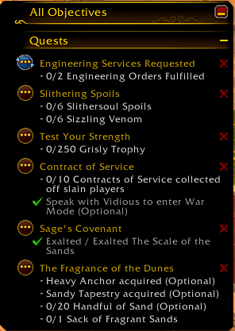
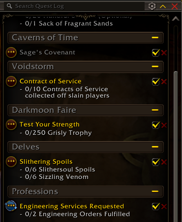

# QuestX

One click, one abandoned quest. QuestX puts a small red X on each quest in the objective tracker and the quest log. Click it and the quest is gone, with no menus and no popup.

## Features

- **One-click abandon.** Every quest you can abandon gets a red X, lined up in the same spot for each quest.
- **Tracker and quest log.** The X sits in the top-right corner of each quest in the objective tracker, and next to the tracking checkbox in the quest log. Each one can be switched off on its own.
- **Only where it makes sense.** The X only shows on quests the game lets you abandon.
- **Optional safety.** Turn on Alt-click so a stray click can't throw a quest away.
- **Know what you dropped.** A chat message names the abandoned quest and any quest items that were removed with it.

## Using it

| Action | What it does |
| --- | --- |
| Click the X | Abandon that quest |
| Alt+click the X | Abandon that quest (when Alt-click is turned on) |
| Hover the X | Show which quest it abandons |

## Slash commands

| Command | What it does |
| --- | --- |
| `/questx` | Show the commands and what each setting is set to |
| `/questx toggle` | Show or hide the red X in the objective tracker |
| `/questx log` | Show or hide the red X in the quest log |
| `/questx alt` | Require Alt-click to abandon |
| `/questx tooltip` | Show or hide the tooltip on the X |
| `/questx chat` | Show or hide the chat message after abandoning |

## Notes

- Made for the current retail game (Midnight), with Blizzard's own objective tracker and quest log. Replacement quest trackers aren't supported.
- Abandoning a quest can't be undone. If you want a safety step, turn on Alt-click with `/questx alt`.
- QuestX only adds its own buttons. It doesn't change Blizzard's code, so quest item buttons keep working in combat.